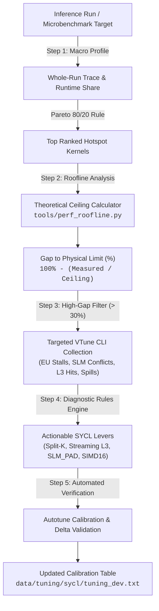

# Intel Xe/Xe2 Hardware-Counter & Roofline Optimization Guide

This guide establishes a mechanical, script-driven methodology for profiling, analyzing, and optimizing pure SYCL 2020 kernels on Intel GPU architectures (Intel Lunar Lake Xe2-LPG, Intel Arc Battlemage B580 Xe2-HPG, and Intel Arc Alchemist Xe-HPG).

---

## 1. The Core Philosophy: Mechanical Kernel Optimization

Traditional kernel optimization often relies on trial-and-error: adjusting workgroup sizes, unrolling loops, or toggling cache hints without knowing the physical bottleneck. 

This framework replaces guesswork with a **5-step closed-loop mechanical workflow**:



1. **Step 1: Macro-Profile & Pareto Ranking**: Profile the full forward pass (prompt processing or token decode) to rank kernels by execution time share. Only optimize kernels accounting for the top 80% of runtime.
2. **Step 2: Roofline Theoretical Distance**: For each hot kernel, compute the algorithmic arithmetic intensity ($I = \text{FLOPs} / \text{Byte}$) and the theoretical hardware ceiling. Quantify the **Gap to Theoretical Limit**:
   $$\text{Gap} = 100\% - \left(\frac{\text{Measured Performance}}{\text{Theoretical Ceiling}} \times 100\%\right)$$
3. **Step 3: Targeted Deep-Dive**: For kernels with a large gap ($> 30\%$), collect hardware performance counters via Intel VTune CLI (`gpu-hotspots`) or Level Zero instrumentation.
4. **Step 4: Mechanical Diagnosis**: Match the counter signature (high stalls, low L3 hits, SLM bank conflicts, scratch spills) against rule-based SYCL code prescriptions.
5. **Step 5: Sweep & Verification**: Calibrate only the prescribed levers using the on-device autotuner (`tune_sycl_kernels`) or microbenchmark suite, verifying the reduction in gap to theoretical limits.

---

## 2. Theoretical Hardware Limits Database

To evaluate how far a kernel is from physical limits, the scripts maintain exact microarchitectural parameters for target Intel GPUs:

| Hardware Target | Microarchitecture | Xe-Cores / VEs | Peak Memory Bandwidth | Peak Adamantine L3 | Peak BF16 XMX | Peak FP32 VE | SLM per Core |
|---|---|---:|---:|---:|---:|---:|---:|
| **Intel Arc B580** (`0xe20b`) | Xe2-HPG (BMG-G21) | 20 / 160 | **456.0 GB/s** (GDDR6) | 1,800 GB/s (16 MB) | **117.0 TFLOPS** | 14.6 TFLOPS | 64 KB (16 banks) |
| **Intel Lunar Lake** (`0x64a0`) | Xe2-LPG (Mobile) | 8 / 64 | **67.2 GB/s** (LPDDR5x) | 750 GB/s (8 MB) | **46.8 TFLOPS** | 5.8 TFLOPS | 64 KB (16 banks) |
| **Intel Arc A770** (`0x56a0`) | Xe-HPG (Alchemist) | 32 / 512 | **560.0 GB/s** (GDDR6) | 1,200 GB/s (16 MB) | **131.0 TFLOPS** | 19.7 TFLOPS | 64 KB (16 banks) |

---

## 3. The Roofline Formulation for SYCL Kernels

For any tensor operation, performance is physically bounded by the **Roofline Model**:

$$\text{Ceiling}(I) = \min\left(\text{Peak TFLOPS}, \; I \times \text{Peak Memory Bandwidth}\right)$$

Where Arithmetic / Operational Intensity is:
$$I = \frac{\text{Theoretical FLOPs}}{\text{Theoretical Transferred Bytes}} \quad \left[\frac{\text{FLOPs}}{\text{Byte}}\right]$$

### Standard Formulas by Kernel Family

1. **Matrix-Vector Multiplication (`gemv`, `s_gemv_q8k`, `bf16_gemv`)**:
   - For batch size $B=1$, input dimension $K$, output dimension $N$:
     $$\text{FLOPs} = 2 \times K \times N$$
     $$\text{Bytes} = (K \times N \times \text{sizeof}(W)) + (K \times \text{sizeof}(X)) + (N \times \text{sizeof}(Y))$$
   - For BF16 weights ($\text{sizeof}(W) = 2$ bytes):
     $$I \approx \frac{2 K N}{2 K N + 2 K + 2 N} \approx 1.0 \text{ FLOP/Byte}$$
   - **Regime**: Deeply **memory-bandwidth bound**. Even with infinite compute, Lunar Lake caps at 67.2 GFLOPS, and Arc B580 caps at 456 GFLOPS. Reaching high memory bandwidth (> 80% of peak) is the sole measure of kernel quality.

2. **Batched GEMM / Prompt Prefill (`gemm_bf16`)**:
   - For prompt chunk length $M$, hidden dimension $K$, projection dimension $N$:
     $$\text{FLOPs} = 2 \times M \times K \times N$$
     $$\text{Bytes} = (K \times N \times 2) + (M \times K \times 2) + (M \times N \times 2)$$
   - For $M=2048, K=2560, N=10240$:
     $$I \approx \frac{2 \times 2048 \times 2560 \times 10240}{52.4\text{ MB} + 10.5\text{ MB} + 41.9\text{ MB}} \approx 100.3 \text{ FLOPs/Byte}$$
   - **Regime**: Deeply **compute bound**. The kernel must saturate the 117 TFLOPS XMX systolic arrays.

3. **Recurrent State Update (`fused_gdn`)**:
   - For state matrix $S \in [H, D_k, D_v]$ ($16 \times 128 \times 128$ floats = 1 MB state):
   - Unfused path writes and reads state back to global DRAM ($2\times 1\text{ MB} = 2\text{ MB}$ per token).
   - Fused SLM path keeps state resident in the 64 KB per-core SLM, eliminating DRAM round-trips.

---

## 4. Intel VTune CLI Recipes

### Recipe 1: Whole-Run Macro Profile (Prompt or Decode)
To identify hot kernels across the full engine without GUI overhead:
```bash
vtune -collect gpu-hotspots \
  -knob characterization-mode=overview \
  -knob compute-engine=all \
  -result-dir ./build_sycl/vtune_macro -- \
  ./build_sycl/strata --tokens 128
```

Export high-level kernel summary to JSON:
```bash
vtune -report summary -result-dir ./build_sycl/vtune_macro -format json -report-output macro_summary.json
```

### Recipe 2: Targeted Instruction & Pipeline Hotspots
Collect Vector Engine active/stalled percentages and assembly instruction hotspots for a specific microbenchmark:
```bash
vtune -collect gpu-hotspots \
  -knob profile-gpu-instructions=true \
  -knob compute-engine=all \
  -knob source-line-level=basic \
  -result-dir ./build_sycl/vtune_deep -- \
  ./build_sycl/perf_xe2_gemv --benchmark_filter="BM_Xe2_GEMV/2560/48/1"
```

### Recipe 3: Memory Subsystem & SLM Bank Conflicts
Measure SLM bank collisions, L3 cache hit rate, and GTI bus saturation:
```bash
vtune -collect gpu-hotspots \
  -knob profile-gpu-instructions=true \
  -knob memory-bandwidth=true \
  -result-dir ./build_sycl/vtune_mem -- \
  ./build_sycl/perf_fused_gdn --benchmark_filter="BM_Xe2_GDN_Fused_SLM"
```

---

## 5. Diagnostic Decision Tree & SYCL Code Levers

When VTune CLI hardware counters are extracted, the mechanical prescription engine maps counter anomalies to specific SYCL 2020 transformations:

```
[Hardware Counter Anomaly]             [Root Cause]                             [SYCL 2020 Code Fix]
├── High EU Array Idle (> 40%)     ──> Under-subscribed Xe-cores            ──> Split-K reduction (TPR = 64..256)
├── High EU Stalled + Low L3 Hit   ──> Weight loads evict hot KV cache       ──> Xe2 streaming L3 hint (annotated_ptr)
├── SLM Bank Conflicts (> 5%)      ──> 16-bank stride collisions             ──> Local memory padding (SLM_PAD = 4)
├── Scratch Memory Spills (> 0 B)  ──> Register exhaustion (> 128/256 GRF)   ──> Subgroup [[reqd_sub_group_size(16)]]
└── Low XMX Active on GEMM         ──> Scalar math instead of systolic arrays ──> sycl::ext::oneapi::matrix::joint_matrix
```

### 1. Split-K Threads-Per-Row (`TPR`)
For narrow columns ($N=48$ or $N=64$), one subgroup per row leaves > 70% of Xe-cores idle. Assign multiple subgroups along the $K$ dimension and reduce partial sums in SLM:
```cpp
// Distribute K dimension across multiple subgroups (TPR = 128)
const uint32_t tpr = 128;
const uint32_t k_per_thread = (K + tpr - 1) / tpr;
// Each thread accumulates locally, then fast SLM tree reduction
```

### 2. Intel Xe2 Streaming L3 Cache Hints (`annotated_ptr`)
During autoregressive decode, model weights are read once and never reused in that step. Standard cached loads pollute the Adamantine L3 cache, displacing hot KV cache and layer activations:
```cpp
#include <sycl/sycl.hpp>

using namespace sycl::ext::oneapi::experimental;
using namespace sycl::ext::intel::experimental;

template <typename T>
using StreamingPtr = annotated_ptr<
    const T,
    decltype(properties(
        read_hint<cache_control<cache_mode::streaming, cache_level::L3>>
    ))>;
```

### 3. SLM Bank Conflict Elimination
Intel Xe/Xe2 SLM has 16 independent memory banks (4 bytes per bank). Stride accesses of 16, 32, 64, or 128 elements hit the exact same bank across all SIMD16 lanes, serializing access:
```cpp
// Add compile-time pad to offset bank indices
constexpr int SLM_PAD = 4;
sycl::local_accessor<float, 2> s_tile(sycl::range<2>(16, 16 + SLM_PAD), cgh);
```

### 4. Register Pressure & Subgroup Sizing
SIMD32 execution divides the physical register file among 32 work-items, leaving only 128 registers per lane. When a complex dequantization or fused attention kernel spills to scratch memory:
1. Enforce native SIMD16: `[[sycl::reqd_sub_group_size(16)]]`, doubling registers per lane.
2. Pass Level Zero compiler flag: `-Xsycl-target-backend "-options -ze-opt-large-register-file"`.

---

## 6. Using the Automated Script (`tools/perf_roofline.py`)

The standalone Python CLI `tools/perf_roofline.py` automates this entire methodology. It runs on this machine against the compiled `perf_*` binaries or on target hardware.

### Quick Start Commands

```bash
# 1. Run live Roofline analysis on GEMV microbenchmark
python3 tools/perf_roofline.py --benchmark perf_xe2_gemv --filter "BM_Xe2_GEMV/2560/48/1"

# 2. Compare Untuned baseline vs Tuned Split-K on live GPU
python3 tools/perf_roofline.py --benchmark perf_xe2_gemv \
  --compare "BM_Xe2_GEMV/2560/48/1" "BM_Xe2_GEMV_SplitReduction/2560/48/1/128"

# 3. Analyze GDN Recurrence and inspect SLM padding impact
python3 tools/perf_roofline.py --benchmark perf_fused_gdn \
  --compare "BM_Xe2_GDN_Unfused/16/16" "BM_Xe2_GDN_Fused_SLM/16/16"

# 4. Generate comprehensive Markdown report
python3 tools/perf_roofline.py --benchmark perf_xe2_gemv --report roofline_gemv.md

# 5. Dry-run mode for environments without a GPU
python3 tools/perf_roofline.py --mock --report mock_report.md
```
