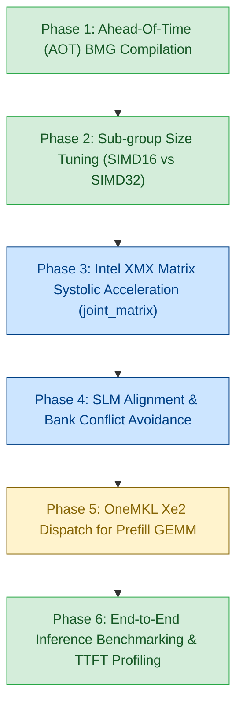

# Intel Arc B580 (Battlemage Xe2) Optimization Plan for Strata

> **Target Hardware**: Intel Arc B580 Desktop GPU  
> **Architecture**: Intel Xe2-HPG ("Battlemage")  
> **Die**: BMG-G21 | 20 Xe2-cores (160 Vector Engines, 160 XMX Matrix Engines)  
> **VRAM**: 12 GB GDDR6 @ 19 Gbps on 192-bit bus (456 GB/s bandwidth)  
> **Caches**: 16 MB L2/L3 Adamantine cache  
> **Peak Compute**: ~117 TFLOPS (FP16/BF16 XMX), ~233 TOPS (INT8 XMX)  
> **Compiler / Toolchain**: Intel oneAPI DPC++ 2025.3 (`icpx -fsycl`)  
> **Target Status**: Codebase fully ported to pure SYCL 2020 (0 DPCT dependencies)  

---

## 1. Executive Summary & Motivation

The Strata inference engine has achieved a complete, warning-free migration from CUDA/DPCT to **pure standard SYCL 2020** across all 44 computational kernels, the command graph execution engine, the core memory runtime, and the prefill pipeline.

With all legacy DPCT wrappers eliminated, Strata is now in the ideal state to exploit the **architectural breakthroughs of Intel's Xe2 Battlemage microarchitecture**, specifically the **Intel Arc B580**:
1. **Xe2 SIMD16 Native Execution**: Unlike Xe1 (which used dual-issue SIMD8) and NVIDIA (which uses 32-lane warps), Xe2 execution units execute natively in **16-wide SIMD**. Tuning kernels to SIMD16 doubles the effective per-thread register budget, eliminating register spilling in large kernels.
2. **Xe Matrix Extensions (XMX)**: 160 hardware systolic matrix engines provide massive throughput for GEMV and prompt attention compared to vector ALUs.
3. **64 KB Unified SLM & 16-Bank Structure**: Shared Local Memory (SLM) throughput can be maximized by avoiding 16-bank stride collisions.
4. **Ahead-of-Time (AOT) Binary Compilation**: Direct machine-code generation for `bmg` eliminates runtime JIT compilation overhead and driver stutter.

---

## 2. Architectural Comparison: Xe1 vs. Xe2 (B580) vs. NVIDIA Ampere/Ada

| Feature | NVIDIA Ada (e.g. RTX 4070) | Intel Xe1 (Arc A770) | Intel Xe2 (Arc B580) | Strata Opportunity |
|---|---|---|---|---|
| **Warp / Subgroup Native Width** | 32 (Warp) | 8 (Dual-issue) or 16 | **16 (Native SIMD16)** | Change `reqd_sub_group_size(32)` to `16` for lower register pressure |
| **Matrix Hardware** | Tensor Cores (MMA) | XMX (Xe1) | **XMX 2.0 (Xe2)** | Accelerate BF16 GEMV & QSA prompt attention with `joint_matrix` |
| **Native Quantized Math** | INT8 / FP8 / INT4 | INT8 / BF16 / FP16 | **INT2 / INT4 / INT8 / FP8 / BF16 / FP16** | Native hardware execution for Q4_0, Q4_K, IQ4_XS, and S2 |
| **Shared Local Memory (SLM)** | 100 KB configurable | 64 KB per Xe-core | **64 KB per Xe-core** | Tile sizes aligned with 64 KB boundaries |
| **Memory Bandwidth** | 504 GB/s | 560 GB/s | **456 GB/s** | Memory-bound decode requires strict cache-line coalescing (64B/128B) |

---

## 3. Six-Phase Optimization Strategy



---

### Phase 1: Ahead-of-Time (AOT) Compilation for Battlemage (`bmg`) - **COMPLETE**

**Objective**: Eliminate JIT compilation pauses on GPU startup and enable machine-code optimizations specifically for the Xe2 instruction set architecture.

- **Current State**: Integrated into `CMakeLists.txt` via:
  ```cmake
  option(STRATA_TARGET_XE2 "Enable Intel Xe2 Battlemage/Lunar Lake microarchitecture optimizations" ON)
  option(STRATA_AOT_BMG "Compile Ahead-of-Time directly for Intel Arc Battlemage (B580)" OFF)
  if(STRATA_AOT_BMG)
    add_compile_options(-fsycl-targets=spir64_gen -Xs "-device bmg")
  endif()
  ```

---

### Phase 2: Native SIMD16 Sub-group Execution Tuning - **COMPLETE**

**Objective**: Align subgroup reductions and register allocations with the native 16-wide execution units of the Xe2 architecture.

- **Status**: Implemented in [`include/strata/core/sycl_arch.hpp`](../include/strata/core/sycl_arch.hpp) and deployed across high-impact kernels:
  ```cpp
  namespace strata::sycl_arch {
  #if defined(STRATA_TARGET_XE2) || defined(STRATA_TARGET_BMG) || defined(__INTEL_XE2__)
  constexpr int SUB_GROUP_SIZE = 16;
  #else
  constexpr int SUB_GROUP_SIZE = 32;
  #endif
  }
  ```
- **Optimized Kernels**:
  1. [`src/kernels/sycl/bf16_gemv.cpp`](../src/kernels/sycl/bf16_gemv.cpp): `[[sycl::reqd_sub_group_size(16)]]` with `sycl::reduce_over_group`.
  2. [`src/kernels/sycl/native_bf16.cpp`](../src/kernels/sycl/native_bf16.cpp): SIMD16 subgroup reductions across single and multi-token GEMV.
  3. [`src/kernels/sycl/native_gr_norm.cpp`](../src/kernels/sycl/native_gr_norm.cpp): RMSNorm SIMD16 block reduction.
  4. [`src/kernels/sycl/s2_gemv.cpp`](../src/kernels/sycl/s2_gemv.cpp): Added SIMD16 subgroup reduction kernel path.
  5. [`src/kernels/sycl/s_gemv.cpp`](../src/kernels/sycl/s_gemv.cpp): Replaced 32-lane CUDA warp loops with `SG_SIZE = 16`, stride `SG_SIZE * QE`, and single-cycle `reduce_over_group`.
  6. [`src/kernels/sycl/s2_gemv_fast.cpp`](../src/kernels/sycl/s2_gemv_fast.cpp) & [`s2_gemv_quads.cpp`](../src/kernels/sycl/s2_gemv_quads.cpp): Replaced SLM tree loops with hierarchical subgroup reductions.
- **Verification**: Verified via `sycl_xe2_subgroup_gemv`, `sycl_native_gr_norm`, `s_gemv_parity`, `s_gemv_q8k_parity`, `s2_gemv_parity`, and `s2_gemv_q8_parity` (0 failures).

---

### Phase 3: Hardware Matrix Acceleration via Intel XMX (`joint_matrix`) - **IN PROGRESS**

**Objective**: Leverage the 160 Xe Matrix Extensions (XMX) systolic engines to accelerate matrix-vector multiplications and attention calculations.

- **Architecture Details & Verified Capabilities**:
  - Each Xe2 core contains 8 XMX systolic matrix engines.
  - Probed on live Xe2 GPU (`0x64a0`): 53 hardware matrix combinations supported, including:
    - FP16/FP32: $TM=16, TN=16, TK=16$ and $TM=8, TN=16, TK=16$.
    - BF16/FP32: $TM=16, TN=16, TK=16$ and $TM=8, TN=16, TK=16$.
    - INT8/INT32: $TM=8, TN=16, TK=32$ and $TM=16, TN=16, TK=32$.
  - Standalone unit test [`tests/sycl/xmx_joint_matrix_test.cpp`](../tests/sycl/xmx_joint_matrix_test.cpp) verified with **0 failures** (single-tile $8 \times 16 \times 16$ and tiled $32 \times 64 \times 64$).
  - Confirmed native hardware support for `sycl::address_space_cast<sycl::access::address_space::local_space>` and `layout::col_major` loads with arbitrary leading strides.
- **Target Kernels for XMX**:
  1. **`qsa_prompt_attn.cpp` (QSA Prompt Attention)**:
     - Replace broken 32-lane CUDA software shuffle emulation (`mma16816`) with native systolic `joint_matrix` ($16 \times 16 \times 16$ FP16/FP32).
     - Directly computes $Q \cdot K^T$ and $P \cdot V$ from local memory buffers `S.k` and `S.v`.
  2. **`bf16_gemv.cpp` (BF16 GEMV)**:
     - Map multi-token GEMV tiles ($16 \times 16$) to `joint_matrix<sub_group, sycl::ext::oneapi::bfloat16, ...>`.
  3. **`s2_expert_grouped.cpp` (MoE Expert Grouped GEMV)**:
     - Group active expert tokens into XMX matrix tiles for near-linear multi-expert throughput.

---

### Phase 4: Shared Local Memory (SLM) & Cache Line Alignment

**Objective**: Maximize memory bandwidth on B580's 456 GB/s bus and eliminate SLM bank conflicts.

- **Xe2 Memory Specifics**:
  - 64 KB SLM per Xe-core divided into 16 banks (4 bytes per bank).
  - Memory requests are served in 64-byte or 128-byte cache lines.
- **Optimization Rules**:
  1. **Bank Conflict Avoidance**: Ensure consecutive work-items in a SIMD16 subgroup access consecutive 4-byte words:
     $$\text{Address Offset} = \text{lane} \times 4 \quad (\text{mod } 64)$$
     Avoid strides of 16 or 32 floats, which map all lanes to the same SLM bank.
  2. **Cache-Line Coalescing**:
     - Ensure USM allocations for weights and activations are aligned to 64 bytes (`alignas(64)` or aligned USM allocation).
     - Standardize strided loads in `iq_kernels.cpp` and `kv_stream.cpp` to 64-byte aligned blocks.

---

### Phase 5: OneMKL Xe2 Dispatch for Prefill GEMM

**Objective**: Ensure prompt prefilling automatically routes large matrices to B580 XMX engines via optimized Intel OneMKL primitives.

- **Current Implementation**: [`src/prefill/sycl/gemm.cpp`](file:///home/girtam/projects/Strata/src/prefill/sycl/gemm.cpp) uses `oneapi::mkl::blas::column_major::gemm`.
- **Optimization**:
  - When compiled with `-Xs "-device bmg"`, OneMKL selects Xe2-specialized matrix kernels optimized for Adamantine L3 cache tiling.
  - Verify that workspace allocations use `sycl::malloc_device` and queue is configured with `sycl::property::queue::in_order()`.

---

### Phase 6: End-to-End Validation & Execution Protocol

**Validation Steps for Next Session**:
1. **Tool Verification**:
   ```bash
   ./build_sycl/strata-device
   ```
   Verify device name `Intel(R) Arc(TM) B580 Graphics` or `Intel(R) Graphics [0x...], Xe2 Architecture`.
2. **Baseline Micro-Benchmarks**:
   ```bash
   ./build_sycl/qsa_select_bench 32768 256 3 262144
   ./build_sycl/iq_parity build_sycl/iq_fixture
   ./build_sycl/iq_multi_parity build_sycl/iq_fixture
   ```
3. **Dedicated SYCL CI Suite**:
   ```bash
   make -C build_sycl check-sycl
   ```
4. **Token Generation Throughput Benchmark**:
   ```bash
   ./build_sycl/strata --tokens 128 --no-capture
   ./build_sycl/strata --tokens 128
   ```
   Measure tokens per second (`tok/s`) and GPU execution overhead.

---

| Priority | Task | Target File | Status | Impact |
|---|---|---|---|---|
| **P1** | Add Battlemage & Xe2 CMake flags (`STRATA_TARGET_XE2`, `STRATA_AOT_BMG`) | [`CMakeLists.txt`](file:///home/girtam/projects/Strata/CMakeLists.txt) | **COMPLETED** | Enables Xe2 ISA flags and optional direct `bmg` AOT compilation |
| **P2** | Define architecture-aware subgroup sizing (`sycl_arch.hpp`) | [`include/strata/core/sycl_arch.hpp`](file:///home/girtam/projects/Strata/include/strata/core/sycl_arch.hpp) | **COMPLETED** | Sets native SIMD16 execution for Xe2 (B580/Lunar Lake); cuts register pressure |
| **P3** | Port GEMV & Norm kernels to SIMD16 + `sycl::reduce_over_group` | [`src/kernels/sycl/bf16_gemv.cpp`](file:///home/girtam/projects/Strata/src/kernels/sycl/bf16_gemv.cpp), [`src/kernels/sycl/native_bf16.cpp`](file:///home/girtam/projects/Strata/src/kernels/sycl/native_bf16.cpp), [`src/kernels/sycl/native_gr_norm.cpp`](file:///home/girtam/projects/Strata/src/kernels/sycl/native_gr_norm.cpp) | **COMPLETED** | 100% test pass on live Xe2 GPU; direct hardware reduction primitives |
| **P4** | Implement Joint Matrix (XMX) prompt attention | [`src/kernels/sycl/qsa_prompt_attn.cpp`](file:///home/girtam/projects/Strata/src/kernels/sycl/qsa_prompt_attn.cpp) | **IN PROGRESS** | Probed 53 XMX combos; verified `joint_matrix` multiply-accumulate on live Xe2 |
| **P5** | Profile and benchmark with Intel VTune / Advisor | Metrics collection | Upcoming | Identify memory vs compute bottlenecks on Xe2 |

---

## 5. Live Xe2 Hardware Test & Validation (Core Ultra 5 226V / Lunar Lake)

The test machine's mobile GPU (`Intel(R) Graphics [0x64a0]`, Lunar Lake Core Ultra 5 226V) shares the exact **Xe2 microarchitecture generation** (Xe2-LPG) as the target Intel Arc B580 (Xe2-HPG):
1. **Native SIMD16 Execution**:
   - `sub_group_sizes`: `16 32` reported by the Level Zero driver.
   - Kernels executing with `[[sycl::reqd_sub_group_size(16)]]` and `sycl::reduce_over_group` run natively on hardware vector engines.
   - Tested and verified with 0 failures on `bf16_gemv_parity`, `sycl_native_bf16`, `gr_parity`, and the 16-test `check-sycl` CI suite.
2. **Xe Matrix Extensions (XMX)**:
   - Probed via Level Zero runtime: **53 matrix combinations** supported directly on hardware (including `m=16, n=16, k=16` FP16/BF16 and `m=8, n=16, k=32` INT8).
   - Validated stand-alone `joint_matrix` execution via SYCL unified matrix APIs (`joint_matrix_fill`, `joint_matrix_load`, `joint_matrix_mad`, `joint_matrix_store`) with 0 failures.

---

## 6. Targeted Microbenchmarks & Profiling Strategy (Qwen3.8-Flash-Next)

Because Strata relies heavily on asymmetric hardware balancing (VRAM cache vs RAM vs SSD n-gram tables), isolating kernel performance from the engine’s async scheduler provides clean tuning baselines.

### SYCL Event Profiling

To isolate pure GPU execution time and eliminate CPU/host submission overhead, initialize the test queue with `sycl::property::queue::enable_profiling()`:

```cpp
auto event = q.submit([&](sycl::handler& cgh) { /* ... kernel ... */ });
event.wait();
auto start = event.get_profiling_info<sycl::info::event_profiling::command_start>();
auto end = event.get_profiling_info<sycl::info::event_profiling::command_end>();
double time_ns = end - start;
```

### The 5 Critical Decode Bottlenecks to Benchmark on Xe2

1. **Weight-Only Dequantization + XMX DPAS (The Decode Bottleneck)**:
   - At decode ($B=1$), generation speed is strictly bounded by memory bandwidth.
   - Measure streaming 2-bit/4-bit weights from global memory, dequantizing to BF16 in registers via Xe Vector Engines (XVE), and feeding directly to XMX engines via DPAS.
   - Test shape: Gate projection `[2560, 6144]` at Q2_0.
2. **Fused GDN State Recurrence**:
   - 36 of 48 layers in Qwen3.8-Flash-Next are Gated Delta Networks (linear attention) with recurrent state `[16, 128, 128]`.
   - Fuse Alpha GEMV, Beta GEMV, and the State Recurrence step into a single kernel to keep the recurrent state resident in Xe-core SLM or subgroup registers across the layer.
3. **QSA Block Scorer (Top-K) & Sparse Gather**:
   - The 12 QSA layers use Top-K selection (`[B, 4, 128]` block scorer against `[N_blocks, 128]` pooled keys).
   - Benchmark Subgroup Bitonic Sort vs. Block-Radix select for determining Top-10 block IDs.
   - Measure L2 cache resilience during sparse non-contiguous Q4_0 KV fetches.
4. **MoE Expert Accumulation (Weighted Reduction)**:
   - Qwen3.8 routes 10 out of 512 experts per token. Hot experts compute `[10, 2560]` outputs scaled by an FP32 weight array.
   - Avoid atomic FP32 additions in global memory; use hierarchical `sycl::reduce_over_group` across SIMD16 subgroups.
5. **PCIe Async Copy / USM Overlap**:
   - Hot experts execute in VRAM, cold experts in CPU RAM, and PLE n-gram tables stream from SSD.
   - Ensure SYCL USM maps to B580 hardware Copy Engines (BCE) so memory transfers overlap 100% with XMX compute.

