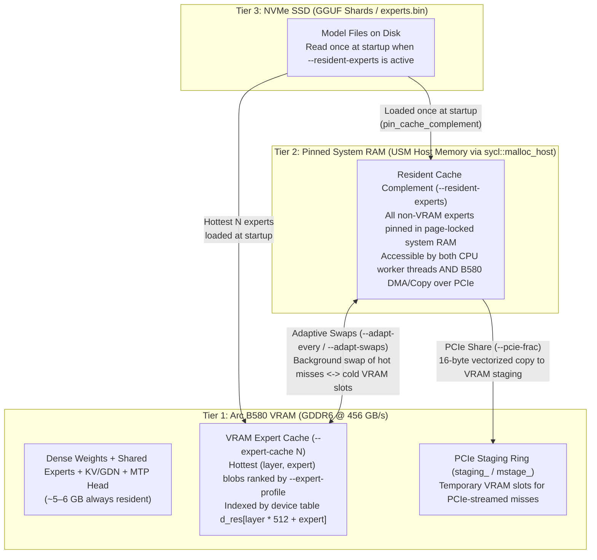
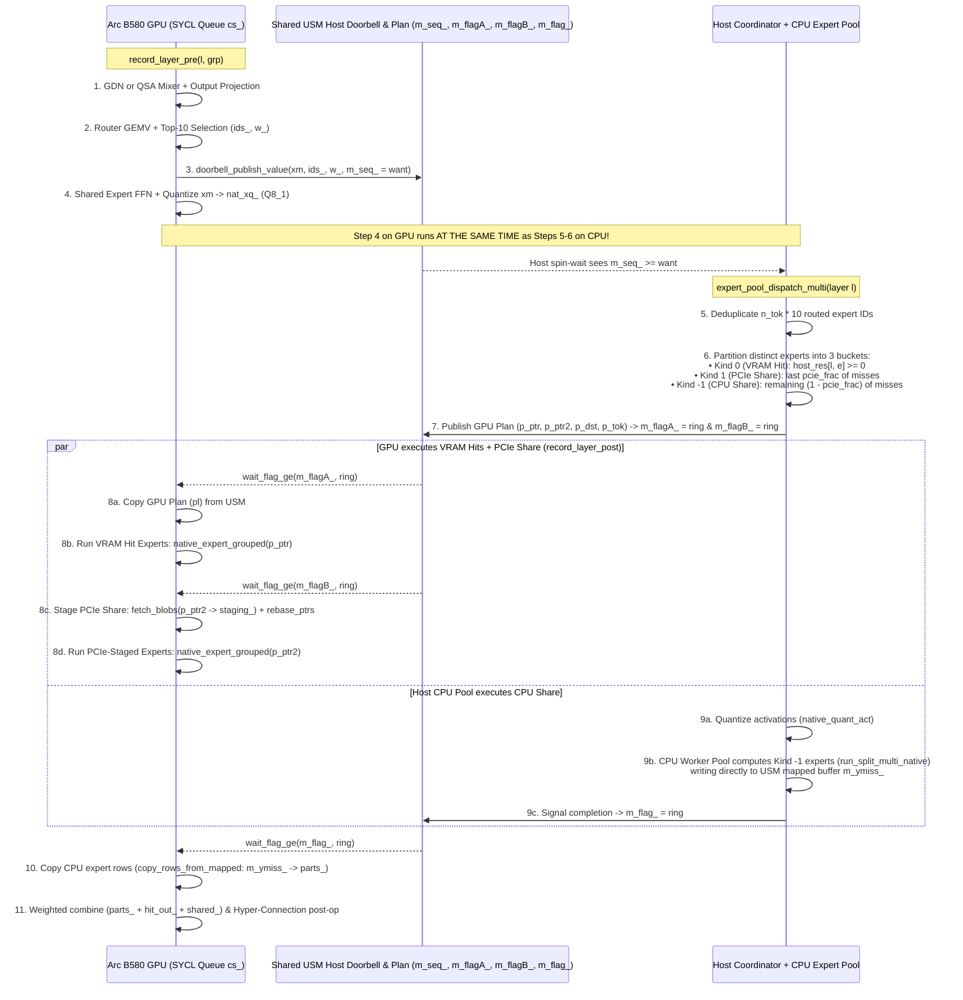

# How Strata Works: Expert Cache, SYCL CPU+GPU Co-Execution & Arc B580 Optimization Guide

This guide explains how Strata executes sparse Mixture-of-Experts (MoE) models on the **Intel SYCL / Level Zero backend** ([`src/program/sycl/generate.cpp`](../src/program/sycl/generate.cpp)), how the **Expert Cache** and **3-tier memory hierarchy** work, how the **host CPU and Arc B580 GPU** co-execute each layer in parallel, and what levers matter most when optimizing on a **12 GB Intel Arc B580**.

---

## 1. Model Architecture & Why the Expert Cache Exists

In Strata's primary MoE architecture (48 layers, $N_{\text{embd}} = 2560$, 4-stream hyper-connections $HC = 4$):
- **Attention / Sequence Mixers (3:1 hybrid across 48 layers)**:
  - **36 GDN (Gated DeltaNet) layers**: Linear-time recurrent state-space layers ($[128 \times 32 \times 128]$ state + short conv).
  - **12 QSA (Quantized Sparse Attention) layers**: Exact block-sparse attention with a learned 64-dim lightning indexer that scores 64-token blocks and selects the top-$K$ blocks per token.
- **MoE Feed-Forward Network (every layer)**:
  - **1 Shared Expert**: Always runs on the GPU for every token.
  - **512 Routed Experts per layer** ($48 \times 512 = 24,576$ total expert FFN blocks across 48 layers, or $12,288$ in 24-layer variants): A router (`ffn_gate_inp.weight`) scores all 512 experts and picks **top-$K = 10$ experts per token**.
- **Per-Layer Embeddings (PLE)**: 4-gram hash tables (`per_layer_token_embd.weight`) looked up per token and projected on the GPU.

> [!IMPORTANT]
> **The Fundamental Bottleneck on a 12 GB GPU**:
> All dense weights (attention, GDN, routers, shared experts, LM head, MTP draft head) and KV/GDN state fit comfortably inside the Arc B580's 12 GB GDDR6 (~4.5–5.5 GB total), so **100% of non-routed-expert math runs on the B580 GPU**.
> However, the 512 routed experts per layer total **~30–40 GB** even in 2-bit/3-bit i-quant formats (`IQ2_XXS`, `IQ2_XS`, `IQ3_XXS`, `IQ3_S`)—far larger than 12 GB VRAM. Yet a single token only touches $10 / 512 \approx 1.95\%$ of the experts in each layer.

---

## 2. The 3-Tier Expert Memory Hierarchy

Strata organizes the routed experts into three tiers managed by [`ExpertCache`](../src/core/sycl/expert_cache.cpp) and [`ExpertSource`](../src/core/sycl/expert_source.cpp):



### How Each Tier Works in Code

1. **Variable-Sized Slot Packing ([`src/program/sycl/generate.cpp`](../src/program/sycl/generate.cpp#L3504-L3525))**:
   - In a native i-quant pack (`--native`), different layers use different quantization types (`IQ2_XXS`, `IQ2_XS`, `IQ3_XXS`, `IQ3_S`), so expert blob sizes vary by layer (~1.1 MiB to ~1.7 MiB).
   - Instead of cutting uniform slots of `max_blob`, Strata walks `--expert-profile` in hotness order and sizes each slot to the exact 256-byte-aligned size of that `(layer, expert)` pair (`sized_slots`). This fits **~30% more experts into the same VRAM budget**.
   - `d_res[l * 512 + e]` on the GPU and `host_res[l * 512 + e]` on the CPU store the slot index (`>= 0`) for cached experts and `-1` (`kNotResident`) for misses.

2. **Prefill Cache Borrowing ([`src/program/sycl/generate.cpp`](../src/program/sycl/generate.cpp#L4720-L4980))**:
   - Prompt prefill (`--prefill 2048`) needs several hundred MiB of temporary workspace buffers on the GPU.
   - Unless `--no-prefill-borrow` is set, Strata **does not permanently waste VRAM** on prefill buffers. Instead, during a prompt prefill it temporarily **borrows the coldest tail slots** of the VRAM expert cache (`lend_first .. slots-1`), marks them `-1` in `d_res`, runs prefill, and immediately copies those experts back from pinned RAM before token generation starts.

3. **Complement-Only Host Pinning (`--resident-experts`, [`src/core/sycl/expert_source.cpp`](../src/core/sycl/expert_source.cpp#L1550-L1850))**:
   - Without `--mmap-experts`, `ArenaExpertSource` pins *all* experts in RAM (including the ones in VRAM).
   - With `--resident-experts`, `FileExpertSource::pin_cache_complement` pins **only the experts missing from VRAM** (plus the tail slots that prefill borrows) in USM host memory (`sycl::malloc_host`) and page-locks them (`mlock`), leaving `--resident-headroom` (4 GiB default) free.
   - Because they are in USM `malloc_host` memory, **both** the host CPU threads (`src->blob(l, e)`) and the Arc B580 GPU (`src->device_alias(l, e)`) can read them directly with zero OS page faults or SSD reads.

4. **Adaptive VRAM Swapping (`--adapt-every` / `--adapt-swaps`, [`src/program/sycl/generate.cpp`](../src/program/sycl/generate.cpp#L5620-L5710))**:
   - Every routed expert updates an exponentially decayed usage counter (`drive.d.usage`).
   - Every `--adapt-every` rounds (e.g., 16), between verify windows while the GPU is idle between turns/steps, Strata pairs the most-routed missing experts against the least-routed resident experts of the same layer size and swaps up to `--adapt-swaps` experts asynchronously on `adapt_stream`, exchanging their places in pinned RAM (`src.commit_exchanges()`).

---

## 3. How Speculative Decoding & Split Verify Windows Work

Single-token autoregressive decoding is memory-bandwidth bound because reading a 1.4 MiB expert for 1 token does the same memory work as reading it for 4–6 tokens when tokens share routed experts or execute in a batch.

Strata uses **Multi-Token Prediction (MTP)** + **Suffix Prompt Lookup** to draft $T - 1$ candidate tokens on the GPU, then verifies a window of $T$ tokens ($T \le 8$, set by `--spec`) in a single pass through [`Verifier::run`](../src/core/sycl/verify.cpp#L1849-L2120).

### Ping-Pong Split Window (`--spec-split`, on by default)

For any window with $T \ge 2$ tokens, `Verifier` splits the $T$ tokens into two half-windows:
- **Group A**: tokens $[0, \lceil T/2 \rceil)$
- **Group B**: tokens $[\lceil T/2 \rceil, T)$

The GPU queue (`cs_`) interleaves Group A and Group B across layers ([`src/core/sycl/verify.cpp`](../src/core/sycl/verify.cpp#L689-L695)):

```
pre(0, A) -> pre(0, B) -> post(0, A) -> pre(1, A) -> post(0, B) -> pre(1, B) -> post(1, A) -> ...
```

Why? Because **Group B's attention/GDN mixer in layer $l$ only depends on Group A's mixer state in layer $l$, NOT on Group A's MoE experts!**
This creates a natural pipeline where the host CPU computes Group A's missed experts while the Arc B580 is busy running Group B's attention/GDN mixer and router.

---

## 4. Layer-by-Layer CPU + GPU Co-Execution in the SYCL Backend

In each layer $l$ and half-window group (`A` or `B`), work is split into `record_layer_pre` ([`src/core/sycl/verify.cpp`](../src/core/sycl/verify.cpp#L865-L1245)), the host pool dispatch [`expert_pool_dispatch_multi`](../src/core/sycl/expert_source.cpp#L2060-L2280), and `record_layer_post` ([`src/core/sycl/verify.cpp`](../src/core/sycl/verify.cpp#L1255-L1430)).



### The Three Buckets of Routed Experts in Every Layer

Suppose a half-window has $n_{\text{tok}} = 3$ tokens $\times 10 = 30$ routed expert slots (say, 26 distinct experts after deduplication):
1. **Bucket 0 — VRAM Hits (`kind = 0`)**:
   - Experts where `host_res[l * 512 + e] >= 0`.
   - Placed in `P.ptr` (`p_ptr`). Executed on the Arc B580 directly out of GDDR6 VRAM by `native_expert_grouped` ([`src/kernels/sycl/iq_kernels.cpp`](../src/kernels/sycl/iq_kernels.cpp)).
2. **Bucket 1 — GPU PCIe Share (`kind = 1`, controlled by `--pcie-frac`)**:
   - Among the $n_{\text{miss}}$ distinct experts not in VRAM, the fraction `m = round(n_miss * pcie_frac)` is assigned to the GPU over PCIe ([`src/core/sycl/expert_source.cpp`](../src/core/sycl/expert_source.cpp#L2088-L2148)).
   - With `--pcie-mode copy` (or `auto`, `pcie_mode == 2`), `P.ptr2` holds the USM host `device_alias(l, e)` pointer. The B580 runs `fetch_blobs` (a 16-byte `uint4` vectorized copy kernel over PCIe into VRAM `staging_`), rebases `p_ptr2` to `staging_`, and runs `native_expert_grouped` from VRAM ([`src/core/sycl/verify.cpp`](../src/core/sycl/verify.cpp#L1334-L1346)).
   - Why stage into VRAM first instead of having the expert kernel read USM host memory directly (`--pcie-mode direct`)? Because an expert kernel reads each weight byte multiple times across sub-groups and tokens (`gate`, `up`, `down`); staging once with coalesced 16-byte loads into GDDR6 and running the expert kernel from GDDR6 is much faster than scattered PCIe reads.
3. **Bucket -1 — Host CPU Pool Share (`kind = -1`, fraction $1 - \text{pcie\_frac}$)**:
   - The remaining `n_miss - m` distinct experts are dispatched across the CPU worker threads (`d.pool->run_split_multi_native`, [`src/core/sycl/expert_source.cpp`](../src/core/sycl/expert_source.cpp#L2252-L2255)).
   - Note that if 3 tokens in the window route to the **same** missed expert $e$, `ExpertJobMulti` groups all 3 tokens into a single job (`jb.nt = 3`, [`src/core/sycl/expert_source.cpp`](../src/core/sycl/expert_source.cpp#L2227-L2249)), so the CPU threads read that expert's weights from system RAM **only once** for all 3 tokens.
   - The CPU workers write the output rows directly into USM host-pinned `m_ymiss_`. When finished, the host sets `m_flag_ = ring`, and the B580 copies **only the CPU-computed rows** (`copy_rows_from_mapped`, [`src/core/sycl/verify.cpp`](../src/core/sycl/verify.cpp#L1365-L1367)) into VRAM `parts_`.

---

## 5. How SYCL Command Graphs Work on Arc B580 (`STRATA_VERIFY_GRAPH`)

Notice in the sequence diagram above that the GPU waits on USM host flags (`wait_flag_ge`) and reads dynamically updated plans (`pl`) inside the verify window.
On Intel Arc Xe2 (Level Zero), there are three modes for executing the verify window ([`src/core/sycl/verify.cpp`](../src/core/sycl/verify.cpp#L53-L92)):

| `STRATA_VERIFY_GRAPH` | How It Works | Why It Matters on Arc B580 |
| :--- | :--- | :--- |
| **`split` (Default)** | Captures the prologue, chunks of `STRATA_VERIFY_GRAPH_CHUNK_LAYERS` layers (default `2`), and the epilogue into reusable SYCL command-buffer graphs (`sycl::ext::oneapi::experimental::command_graph`). | Avoids per-kernel Level Zero driver launch overhead across ~1,200 kernel launches per window while avoiding the monolithic 48-layer Level Zero JIT compilation hang. |
| **`direct`** | Submits kernels directly to the in-order SYCL queue (`cs_`) without command graph capture. | Useful for debugging or if a driver version has command-graph bugs, at the cost of higher host launch overhead. |
| **`full`** | Attempts to capture all 48 layers into a single monolithic SYCL command graph. | Not recommended on Arc Xe2 (monolithic 48-layer graphs can stall in Level Zero JIT). |

---

## 6. Optimizing for Intel Arc B580 (12 GB VRAM)

The Intel Arc B580 has **12 GB GDDR6** (~456 GB/s VRAM bandwidth) and a **PCIe Gen4 x8 link** (~12–14 GB/s effective host-to-device bandwidth).

### The Golden Rule of Co-Execution Balance

For each layer's MoE phase, wall-clock time is governed by:
$$T_{\text{MoE}} \approx \max\Big(T_{\text{GPU}}(\text{VRAM hits}) + T_{\text{PCIe}}(\text{PCIe misses}),\;\; T_{\text{CPU}}(\text{CPU misses})\Big)$$

Because the Arc B580 uses a **PCIe x8 interface** (~13 GB/s), pulling too many missed experts over PCIe can stall the B580 on the x8 link while the host CPU finishes early and sits idle. Conversely, setting `--pcie-frac 0` leaves the PCIe link unused while the B580 waits for the CPU pool.

### Key Tuning Knobs & How to Optimize Them

#### 1. Maximize VRAM Expert Cache Slots (`--expert-cache`, `--vram-reserve-mib`, `--kv`)
Every extra expert kept in VRAM removes ~1.4 MiB of system RAM / PCIe traffic when hit:
- **Use `--kv k8v4` (or `q4_0`)**: Reduces QSA KV cache memory to 816 bytes/cell (`k8v4`), freeing VRAM for more expert slots.
- **Right-size `--max-context`**: Only allocate the context you need (e.g., `32768` or `65536`), since QSA KV + indexer tables scale with `--max-context`.
- **Use Prefill Borrowing (do NOT pass `--no-prefill-borrow`)**: Lets the expert cache use the ~1.5 GiB of VRAM that `--prefill 2048` only needs during prompt reading.
- **Right-size `--vram-reserve-mib`**: On B580, `--vram-reserve-mib 1024` to `1280` prevents Level Zero OOM while leaving room for ~1,000–1,400 variable-sized expert slots (or set `--expert-cache -1` to let Strata auto-size to fill available VRAM up to the reserve).
- **Always pass `--expert-profile`** (and `--expert-profile-save` during real workloads): A workload-matched profile dramatically increases the VRAM hit rate of those 1,000 slots because MoE routing is heavily skewed toward domain-specific experts.

#### 2. Balance `--pcie-frac` and `--pool-workers` (The CPU/GPU Split)
- **`--pcie-frac`**:
  - On PCIe x16 (~26 GB/s), Strata defaults to `0.55`.
  - On B580's PCIe x8 link, **`0.25` to `0.35`** is typically optimal depending on host CPU core count and RAM channels.
  - **How to measure directly**: Run with `STRATA_VERIFY_PROFILE=1` for a benchmark turn. It prints per-window averages for `VRAM hits`, `waitB` + `PCIe grp` (GPU PCIe work), and `waitCPU` (time GPU spent waiting for the CPU pool after finishing its own VRAM + PCIe work):
    - If **`waitCPU` is high (> 0.10 ms/layer)**: The CPU pool is the bottleneck $\rightarrow$ **increase `--pcie-frac`** (e.g., `0.35` $\rightarrow$ `0.45`) or adjust `--pool-workers`.
    - If **`waitCPU` is ~0.00 ms and `PCIe grp` is high**: The B580 PCIe link is the bottleneck $\rightarrow$ **decrease `--pcie-frac`** (e.g., `0.35` $\rightarrow$ `0.20` or `0.25`) so the CPU pool takes more of the misses.
- **`--pool-workers`**:
  - Each verify layer typically has ~15–25 CPU expert jobs (`njobs`).
  - Spawning too many SMT threads causes atomic barrier contention and cache thrashing on short (~0.3 ms) bursts.
  - Use **`--pool-affinity p-cores`** and size `--pool-workers` to physical cores (or half to full physical core count on high-core-count CPUs) to saturate memory channels without barrier overhead.

#### 3. Keep Non-VRAM Experts Pinned in RAM (`--resident-experts` & `--ple-io ram`)
- When system RAM permits, keep `--resident-experts` and `--ple-io ram` enabled.
- This guarantees **zero SSD reads** during both prefill and decode, and ensures `src->pinned(l, e)` is true for every missed expert so the `--pcie-frac` share can be copied over PCIe without fallback.

#### 4. Keep Adaptive Swapping Enabled (`--adapt-every 16 --adapt-swaps 8`)
- Because all non-VRAM experts are pinned in RAM (`--resident-experts`), adaptive swaps (`--adapt-every 16 --adapt-swaps 8`) do **not** touch the SSD—they exchange cold VRAM slots with hot RAM experts in the background between turns, steadily raising your VRAM cache hit rate over a coding or chat session.

#### 5. Enable Xe2 Kernel Optimizations in `env`
- **`STRATA_IQ3S_GU_ROW_REUSE=1`**: Reuses the `IQ3_S` gate/up row pointer and scale load across all tokens in the verify window inside [`src/kernels/sycl/iq_kernels.cpp`](../src/kernels/sycl/iq_kernels.cpp#L483-L558), cutting GPU expert kernel overhead on `IQ3_S` layers.
- **`STRATA_ESIMD_LV=2`**: Vectorizes the $V$-accumulation inner loop in the ESIMD DPAS prompt attention kernel ([`src/kernels/sycl/qsa_prompt_attn_esimd.cpp`](../src/kernels/sycl/qsa_prompt_attn_esimd.cpp#L60-L64)), speeding up prompt prefill on QSA layers.
- **`STRATA_VERIFY_GRAPH=split`** and **`STRATA_VERIFY_GRAPH_CHUNK_LAYERS=2`**: Captures 2-layer SYCL command-graph chunks for low launch overhead without Level Zero JIT stalls.
- **Leave `STRATA_VERIFY_NO_HOST` unset**: `STRATA_VERIFY_NO_HOST=1` disables the host CPU pool and forces 100% of misses over the B580's x8 PCIe link; leaving it unset keeps the hybrid CPU + B580 pipeline active.
