# Intel SYCL Fused MoE Prefill Implementation Plan

> **Scope**: Implementation of Strata Fused MoE Prefill (`STRATA_PF_FUSED=1`, #136) for Intel GPUs  
> **Target Hardware**: Intel Arc Xe2 (Battlemage B580 / Lunar Lake) & Intel Arc Xe (Alchemist A770)  
> **Reference Files**: [`src/prefill/moe_fused.cu`](../src/prefill/moe_fused.cu), [`src/prefill/moe_fused_iq.cu`](../src/prefill/moe_fused_iq.cu), [`tests/cuda/prefill_fused_moe_test.cpp`](../tests/cuda/prefill_fused_moe_test.cpp)  
> **Status**: Ready for Implementation (Cleanly Isolated, Opt-In)  

---

## 1. Executive Summary & Objective

In prompt prefill, Mixture-of-Experts (MoE) layers evaluate active experts for each token. Strata currently supports two prefill paths:
1. **Standard MMQ Path** ([`src/prefill/sycl/moe_mmq.cpp`](../src/prefill/sycl/moe_mmq.cpp)): The active path on SYCL. Evaluates expert layers through multiple passes (CPU host sync for routing, per-slot activation quantization to Q8_1, Gate/Up GEMMs, SwiGLU, intermediate activation re-quantization, and Down GEMM).
2. **Fused MoE Path** (`STRATA_PF_FUSED=1`, #136): A fused pipeline developed for CUDA and HIP. Combines GPU-side routing table construction, per-token INT8 activation quantization, and a single fused kernel launch for Gate/Up $\rightarrow$ SwiGLU $\rightarrow$ Down.

On NVIDIA hardware, the fused path delivers **+13% to +23% prompt throughput speedup** by avoiding 5 intermediate memory passes and eliminating host synchronization.

The objective of this plan is to implement the Fused MoE prefill path in pure standard **SYCL 2020** targeting Intel Arc Xe2 hardware (Intel Arc B580) using Intel Xe Matrix Extensions (XMX) systolic hardware.

---

## 2. Pipeline Comparison

```mermaid
flowchart TD
    subgraph MMQ ["Standard MMQ Prefill (Active Path)"]
        M1["Host waits on Router IDs (Host Sync)"] --> M2["Host groups tokens into 16-expert batches"]
        M2 --> M3["Quantize activations to Q8_1 (k times per token)"]
        M3 --> M4["Gate & Up MMQ launches"]
        M4 --> M5["SwiGLU activation writes FP32 to VRAM"]
        M5 --> M6["Quantize intermediate H to Q8_1"]
        M6 --> M7["Down MMQ launch & scatter"]
    end

    subgraph FUSED ["Fused MoE Prefill (Target Path)"]
        F1["Router IDs on GPU"] --> F2["GPU group kernel builds tile tables (Zero Host Sync)"]
        F1 --> F3["Quantize input activations once per token (1x, not k-x)"]
        F2 --> F4["Single Fused Kernel Launch"]
        F3 --> F4
        F4 --> F5["Gate/Up GEMM in registers (XMX INT8)"]
        F5 --> F6["SwiGLU in registers"]
        F6 --> F7["Down GEMM in registers (XMX INT8)"]
        F7 --> F8["Direct output write (Zero intermediate VRAM roundtrips)"]
    end
```



---

## 3. Why Fused MoE Was Inactive on SYCL

The initial SYCL files ([`src/prefill/sycl/moe_fused.cpp`](../src/prefill/sycl/moe_fused.cpp) and `moe_fused_iq.cpp`) were generated by automated conversion tools from CUDA and contain unmigrated NVIDIA primitives:
- `asm volatile("cp.async.ca.shared.global ...")` (NVIDIA hardware async copy).
- `mma_s8` calling NVIDIA Tensor Core PTX (`m16n8k32 s8 x s8 -> s32`).
- Hardcoded compute capability check: `dev_info().cc >= 80`.

Because of these unmigrated calls, [`src/prefill/sycl/prefill.cpp`](../src/prefill/sycl/prefill.cpp#L69-L86) stubs `fused::built()` to return `false`, causing all SYCL prefill to safely run through `moe_mmq.cpp`.

---

## 4. Hardware Mapping on Intel Arc Xe2 (B580)

Intel Arc Xe2 GPUs provide direct hardware equivalents for all fused operations:

| Function | NVIDIA Reference | Intel Arc B580 (Xe2-HPG) Equivalent |
| :--- | :--- | :--- |
| **Matrix Core** | Tensor Core `m16n8k32` (INT8) | **160 XMX Matrix Engines** (`joint_matrix` INT8 $\rightarrow$ INT32, 233 TOPS) |
| **Tile Dimensions** | $M=16, N=8, K=32$ | $TM=8, TN=16, TK=32$ or $TM=16, TN=16, TK=32$ (native hardware support) |
| **Shared Memory Copy** | `cp.async` hardware queue | Pipelined **Shared Local Memory (SLM)** with `sycl::local_accessor` |
| **Subgroup Size** | Warp 32 | **Native SIMD16** (`[[sycl::reqd_sub_group_size(16)]]`) |
| **Universal Fallback** | N/A | Vectorized `sycl::ext::intel::math::dp4a` within SIMD16 subgroup |

---

## 5. Non-Breaking Safety & Isolation Strategy

1. **Opt-in Dispatch**:
   In [`src/prefill/sycl/prefill.cpp`](../src/prefill/sycl/prefill.cpp#L2284-L2286):
   ```cpp
   const bool fused_l = (use_mmq && stream_all && !lay.native && fused::enabled()) || fused_nat;
   ```
   The engine defaults to `moe_mmq.cpp`. `fused::enabled()` only returns true when `STRATA_PF_FUSED=1` is explicitly set in the environment and `fused::available()` confirms hardware support.
2. **Independent Test Harness**:
   Implementation begins by porting the standalone unit test [`tests/cuda/prefill_fused_moe_test.cpp`](../tests/cuda/prefill_fused_moe_test.cpp) to SYCL. The kernel is verified against an independent double-precision CPU reference on synthetic buffers without touching any production serving paths.

---

## 6. Implementation Roadmap

### Phase 1: Standalone Parity Test Harness
- **Target File**: `tests/sycl/prefill_fused_moe_parity.cpp`
- Port `tests/cuda/prefill_fused_moe_test.cpp` to SYCL 2020:
  - Allocate test buffers via `sycl::malloc_device` and `sycl::queue`.
  - Generate synthetic Q2_0 blobs and skewed token routing ($T=256$ tokens, $E=64$ experts, top-10).
  - Implement the CPU double-precision reference (dequantized FP32 Gate/Up $\rightarrow$ SwiGLU $\rightarrow$ Down).
  - Add to `CMakeLists.txt` under `STRATA_ENABLE_SYCL`.
- **Validation**: Test executable compiles and runs.

### Phase 2: GPU Routing Grouping & Activation Quantization
- **Target File**: `src/prefill/sycl/moe_fused.cpp`
- **Functions**:
  1. `void fused::group(...)`:
     - Reads router `ids` ($T \times K$) on the GPU.
     - Computes expert counts, offsets, and builds 64-row tiles completely in GPU shared memory.
     - Eliminates CPU synchronization.
  2. `void fused::quantize_act(...)`:
     - Quantizes input activations from FP32 to INT8 once per token ($T \times N$).
     - Computes per-32 scale factor $d$ and offset $c = -(1.5 \times 2^{23} + \sum a)$.
- **Validation**: Verify grouping offsets and INT8 quantization outputs match CPU reference in `prefill_fused_moe_parity`.

### Phase 3: Fused GEMM Matrix Kernel (XMX & DP4A)
- **Target File**: `src/prefill/sycl/moe_fused.cpp`
- **Functions**:
  1. `void fused::experts(...)`:
     - Workgroup configuration: 512 threads (32 subgroups of SIMD16) or 256 threads.
     - Load activation tile from SLM into matrix registers:
       ```cpp
       joint_matrix<sub_group, int8_t, use::a, 8, 32, layout::row_major> sub_a;
       joint_matrix<sub_group, int8_t, use::b, 32, 16, layout::ext_intel_packed> sub_b;
       joint_matrix<sub_group, int32_t, use::accumulator, 8, 16> sub_c;
       joint_matrix_mad(sg, sub_c, sub_a, sub_b, sub_c);
       ```
     - Compute Gate and Up projections in parallel.
     - Compute SwiGLU in workgroup registers: $H = \text{silu}(\text{Gate}) \times \text{Up}$.
     - Quantize intermediate $H$ into SLM.
     - Compute Down projection directly into output destination buffer.
  2. Implement DP4A fallback path for Intel GPUs without XMX support.

### Phase 4: Hardware Probing & Capability Guards
- Implement clean device capability detection in `fused::available()`:
  - Query Intel XMX matrix combination support using `sycl::ext::oneapi::experimental::info::device::matrix_combinations`.
  - Confirm minimum compute units and SLM size ($\ge 64$ KB).
  - Return `true` on Intel Arc B580 / Lunar Lake / Alchemist when compatible.

### Phase 5: Prefill Pipeline Integration
- Update `CMakeLists.txt`:
  - Add `src/prefill/sycl/moe_fused.cpp` to `strata_prefill` library when `STRATA_ENABLE_SYCL` is active.
  - Define `STRATA_PREFILL_FUSED=1`.
- Update [`src/prefill/sycl/prefill.cpp`](../src/prefill/sycl/prefill.cpp):
  - Remove `#ifndef STRATA_PREFILL_FUSED` stubs.
  - Connect `fused::built()`, `fused::available()`, `fused::enabled()`, and `fused::experts()` to the implementation.

### Phase 6: Validation & Regression Suite
- Run `prefill_fused_moe_parity`:
  - Verify output accuracy against CPU double-precision reference (RMS error $\le 1.5\times$ of MMQ path, maximum row error $\le 2.0\times$).
- Run full CTest suite:
  - `ctest -R "sycl_|verify|parity|sampler"`: ensure 100% pass rate (104/104 tests) is maintained with zero regressions.

---

## 7. Verification & Acceptance Criteria

1. **Precision Acceptance**:
   - Fused output error compared to FP64 golden reference must not exceed $1.5\times$ MMQ RMS error across all 256 test tokens.
2. **Memory Safety**:
   - 0 out-of-bounds reads/writes on GPU device memory.
   - Guard zeroing verified on non-resident expert slots.
3. **Opt-in Determinism**:
   - With `STRATA_PF_FUSED=0` or unset, default engine execution is 100% byte-identical to current release (`moe_mmq.cpp`).
   - With `STRATA_PF_FUSED=1`, prefill executes via `fused::experts` without host synchronization.
