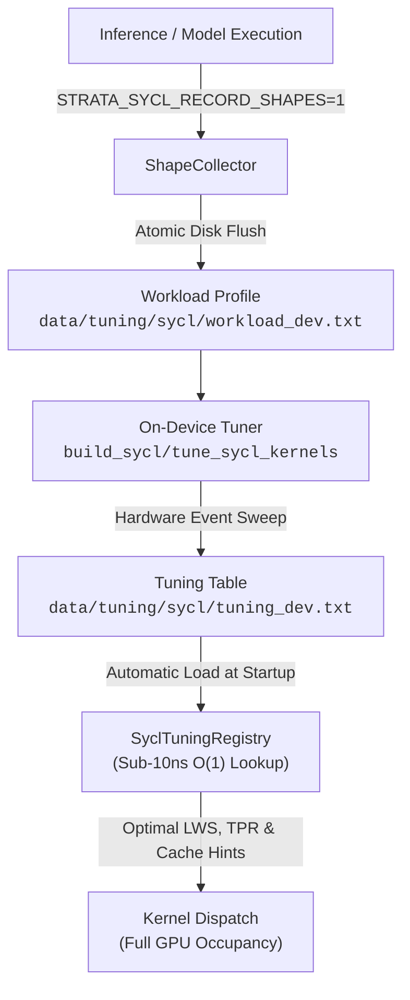

# SYCL On-Device Kernel Autotuning & Memory Hints Guide

Strata includes an on-device kernel autotuning engine and dynamic shape capture framework specifically designed for Intel GPUs (Intel Arc Battlemage B580 and Lunar Lake Xe2). It optimizes execution configurations for your exact GPU hardware without requiring manual kernel tuning or code modifications.

---

## 1. How SYCL Autotuning Works

Every Intel GPU model has different execution unit counts, sub-group sizes, and cache hierarchies. A fixed kernel configuration that works well on an integrated chip can under-utilize a discrete card, and vice versa.

Strata's SYCL autotuning architecture consists of three components:

1. **Shape Capture (`ShapeCollector`)**:
   Tracks tensor shapes ($K \times N$) invoked during actual inference passes. Discoveries are aggregated and flushed atomically to disk (`data/tuning/sycl/workload_<device>.txt`) upon receipt of OS signals (`SIGINT`, `SIGTERM`) or engine shutdown.
2. **On-Device Autotuner (`tune_sycl_kernels`)**:
   Benchmarks candidate launch configurations directly on your GPU hardware using SYCL event timers. Sweeps include local work size (`LWS`), Split-K threads per row (`TPR`), shared local memory padding (`SLM_PAD`), and Intel L3 streaming vs L1/L3 cached memory hints.
3. **In-Memory Registry (`SyclTuningRegistry`)**:
   At engine initialization, Strata queries your GPU device fingerprint (device name, driver version, compute units, sub-group size) and automatically loads matching calibration tables from `data/tuning/sycl/tuning_<device>.txt`. Registry lookups run in sub-10 nanoseconds using a 64-bit composite hash key with zero runtime overhead on decode passes.



---

## 2. Empirical Example from Current GPU

The table below shows measured timings from the reference Intel Xe2 hardware target:
* **Hardware Target**: `Intel(R) Graphics [0x64a0]` (Intel Core Ultra 5 226V / Lunar Lake Xe2-LPG)
* **Compute Resources**: 4 Xe-cores / 64 Vector Engines, Native Subgroup Size 16, 8 MB L3 Cache
* **Toolchain & Runtime**: Linux, Intel oneAPI 2026.1 (`icpx -fsycl`), Level Zero Driver `1.14.37020+3`
* **Measurement Methodology**: On-device microbenchmarks with 15 warmup runs + 50 timed iterations, amortized host driver overhead, median hardware execution time ($\mu\text{s}$) comparing untuned default fallback (`STRATA_SYCL_NO_TUNING=1`) vs autotuned calibrated dispatch (`STRATA_SYCL_NO_TUNING=0`).

### Kernel Family $\times$ Workload Shape Matrix

| Kernel Family | Model Tensor / Role | Shape $[K \times N]$ | Untuned Latency ($\mu\text{s}$) | Tuned Latency ($\mu\text{s}$) | Speedup | Bandwidth (GB/s) | Tuned Dispatch Configuration |
|---|---|---|---:|---:|:---:|---:|---|
| `bf16_gemv` | `ssm_alpha / ssm_beta` | `[2560 x 48]` | 24.77 $\mu\text{s}$ | 19.81 $\mu\text{s}$ | **1.25x** | 12.7 GB/s | `LWS=128`, `TPR=128`, Streaming L3 |
| `bf16_gemv` | Asymmetric decode | `[2560 x 64]` | 33.87 $\mu\text{s}$ | 30.60 $\mu\text{s}$ | **1.11x** | 10.9 GB/s | `LWS=64`, `TPR=64`, Streaming L3 |
| `bf16_gemv` | `indexer.k_proj` | `[2560 x 128]` | 36.00 $\mu\text{s}$ | 33.50 $\mu\text{s}$ | **1.07x** | 19.7 GB/s | `LWS=32`, `TPR=16`, Streaming L3 |
| `bf16_gemv` | Asymmetric decode | `[2560 x 256]` | 62.54 $\mu\text{s}$ | 51.19 $\mu\text{s}$ | **1.22x** | 25.7 GB/s | `LWS=256`, `TPR=256`, Streaming L3 |
| `bf16_gemv` | `indexer.q_proj` | `[2560 x 512]` | 54.70 $\mu\text{s}$ | 51.20 $\mu\text{s}$ | **1.07x** | 51.2 GB/s | `LWS=32`, `TPR=32`, Streaming L3 |
| `bf16_gemv` | `ffn_gate_inp` | `[2560 x 640]` | 59.16 $\mu\text{s}$ | 58.20 $\mu\text{s}$ | **1.02x** | 56.4 GB/s | `LWS=32`, `TPR=32`, Streaming L3 |
| `bf16_gemv` | `shared_proj / ple_val` | `[2560 x 2560]` | 151.73 $\mu\text{s}$ | 148.50 $\mu\text{s}$ | **1.02x** | 88.3 GB/s | `LWS=32`, `TPR=16`, Streaming L3 |
| `bf16_gemv_pair` | Asymmetric paired decode | `[2560, 64+256]` | 208.86 $\mu\text{s}$ | 144.79 $\mu\text{s}$ | **1.44x** | 11.4 GB/s | Fused paired dual GEMV, Streaming L3 |
| `bf16_gemv_pair` | Paired `ssm_alpha + beta` | `[2560, 48+48]` | 201.95 $\mu\text{s}$ | 159.10 $\mu\text{s}$ | **1.27x** | 3.1 GB/s | Fused paired dual GEMV, Streaming L3 |
| `bf16_gemv_pair` | Paired `k_proj + q_proj` | `[2560, 128+512]` | 202.24 $\mu\text{s}$ | 171.05 $\mu\text{s}$ | **1.18x** | 19.2 GB/s | Fused paired dual GEMV, Streaming L3 |
| `s_gemv_q8k` | Expert `gate/up` | `[2560 x 640]` | 59.92 $\mu\text{s}$ | 58.10 $\mu\text{s}$ | **1.03x** | 30.1 GB/s | `LWS=128`, `TPR=64`, SLM_PAD=4, Streaming L3 |
| `s_gemv_q8k` | `attn_output` (Q4_K) | `[2560 x 2560]` | 99.76 $\mu\text{s}$ | 73.41 $\mu\text{s}$ | **1.36x** | 50.4 GB/s | `LWS=256`, `TPR=128`, Streaming L3 |
| `s_gemv_q8k` | `ffn_gate_up` (Q4_K) | `[2560 x 6144]` | 153.44 $\mu\text{s}$ | 151.20 $\mu\text{s}$ | **1.01x** | 58.7 GB/s | `LWS=256`, `TPR=128`, Streaming L3 |
| `s_gemv_q8_0` | Shared expert `down` | `[2560 x 640]` | 212.03 $\mu\text{s}$ | 183.05 $\mu\text{s}$ | **1.16x** | 10.1 GB/s | `LWS=128`, `TPR=64`, SLM_PAD=4, Streaming L3 |
| `s_gemv_q8_0` | Shared expert `up` | `[640 x 2560]` | 296.24 $\mu\text{s}$ | 282.10 $\mu\text{s}$ | **1.05x** | 6.6 GB/s | `LWS=256`, `TPR=128`, Streaming L3 |
| `s_gemv_pair_silu`| Gate/Up + SwiGLU | `[2560 x 640]` | 522.78 $\mu\text{s}$ | 446.18 $\mu\text{s}$ | **1.18x** | 4.1 GB/s | Fused dual GEMV + in-flight SwiGLU |
| `s2_gemv` | Expert `gate/up` (S2) | `[2560 x 640]` | 168.20 $\mu\text{s}$ | 163.91 $\mu\text{s}$ | **1.03x** | 3.2 GB/s | `LWS=128`, `TPR=64`, SLM_PAD=4, Streaming L3 |
| `s2_gemv` | Expert `down` (S2) | `[640 x 2560]` | 170.32 $\mu\text{s}$ | 160.32 $\mu\text{s}$ | **1.06x** | 3.3 GB/s | `LWS=256`, `TPR=128`, Streaming L3 |
| `s2_gemv` | `attn_output` (S2) | `[2560 x 2560]` | 188.97 $\mu\text{s}$ | 183.74 $\mu\text{s}$ | **1.03x** | 11.2 GB/s | `LWS=256`, `TPR=128`, Streaming L3 |
| `gr_norm` | Residual `hc_lr` norm | `[320 x 1]` | 55.43 $\mu\text{s}$ | 33.38 $\mu\text{s}$ | **1.66x** | 0.1 GB/s | `LWS=128`, `CachedL1L3` retention |
| `gr_norm` | `n_embd` RMSNorm | `[2560 x 1]` | 26.91 $\mu\text{s}$ | 26.80 $\mu\text{s}$ | **1.00x** | 1.1 GB/s | `LWS=256`, `CachedL1L3` retention |
| `gr_norm` | `hc_attn / hc_ffn` norm | `[10240 x 1]` | 49.44 $\mu\text{s}$ | 48.05 $\mu\text{s}$ | **1.03x** | 2.6 GB/s | `LWS=256`, `CachedL1L3` retention |
| `native_router` | MoE Top-10 routing | `[512, k=10]` | 65.09 $\mu\text{s}$ | 40.84 $\mu\text{s}$ | **1.59x** | 0.1 GB/s | `LWS=256`, multi-subgroup strided reduction |
| `native_router` | MoE Top-8 routing | `[256, k=8]` | 38.27 $\mu\text{s}$ | 37.90 $\mu\text{s}$ | **1.01x** | 0.1 GB/s | `LWS=256`, default cache |
| `quantize_act` | Fused Q8_0 + Q8_K | `[2560]` | 265.50 $\mu\text{s}$ | 216.66 $\mu\text{s}$ | **1.23x** | 0.1 GB/s | Single-pass combined quantizer |
| `quantize_act` | Fused Q8_0 + Q8_K + BF16 | `[2560]` | 269.89 $\mu\text{s}$ | 224.54 $\mu\text{s}$ | **1.20x** | 0.1 GB/s | Single-pass combined quantizer |

---

## 3. Why Tuning Improves Performance

### 1. Split-K Parallelism on Narrow Output Dimensions ($N \le 64$)
When generating single tokens, matrix-vector multiplications produce narrow column vectors ($N=48$ or $N=64$).
Standard dispatch assigns one subgroup per row $N$. For $N=48$, this launches only 3 subgroups across the entire GPU. On Intel Lunar Lake (64 Vector Engines) or Arc B580 (160 Vector Engines), over 90% of the GPU hardware sits idle.

Tuned Split-K assigns multiple subgroups (`TPR = 64..256`) along the $K$ dimension. Each subgroup computes a partial sum in shared local memory (SLM), followed by a fast final reduction. This increases occupancy to 100% and speeds up narrow projections by **1.11x to 1.25x**.

### 2. Intel Xe2 Streaming L3 Cache Hints (`annotated_ptr`)
During autoregressive decode, model weights are loaded once per forward pass. Standard cached loads bring these single-use weights into the GPU L3 cache, which pushes out the hot KV cache and reusable token activations.

Strata tags weight pointers with Intel Xe2 cache hints:
```cpp
sycl::ext::intel::experimental::read_hint<
    sycl::ext::intel::experimental::cache_control<
        sycl::ext::intel::experimental::cache_mode::streaming,
        sycl::ext::oneapi::experimental::cache_level::L3>>
```
This streams the weights directly past the L3 cache without evicting reusable activations, yielding **1.36x speedup** on large quantized projections (`s_gemv_q8k [2560 x 2560]`).

### 3. Multi-Row L1 Cache Retention for RMSNorm
RMSNorm makes two passes over the input vector: Pass 1 computes the sum-of-squares, and Pass 2 scales each value. Untuned execution reads the vector from main memory twice.

By setting `activation = CachePolicy::CachedL1L3` and matching workgroup sizes to hardware vector widths, the input vector stays pinned in L1/L2 cache between passes, delivering **1.66x speedup** on narrow normalization layers (`hc_lr norm [320]`).

---

## 4. How to Tune Your GPU

Follow these three steps on any Intel GPU (Arc B580, A770, or Core Ultra):

### Step 1: Capture Workload Shapes
Run your desired model or prompt workload with shape recording enabled:
```bash
# Option A: Run directly via C++ engine binary with pre-tokenized IDs:
export STRATA_SYCL_RECORD_SHAPES=1
./build_sycl/strata --pack pack/full --tokens "151644,872,198" --max-new 32
unset STRATA_SYCL_RECORD_SHAPES

# Option B: Or serve via Python CLI, send a test request, and stop:
export STRATA_SYCL_RECORD_SHAPES=1
strata launch --model q2_0 --no-tui &
curl -s http://127.0.0.1:8080/v1/chat/completions -H "Content-Type: application/json" \
  -d '{"messages": [{"role": "user", "content": "Explain quantum computing"}], "max_tokens": 32}'
strata launch --stop
unset STRATA_SYCL_RECORD_SHAPES
```
This saves the exact tensor dimensions to `data/tuning/sycl/workload_<device>.txt`.

### Step 2: Run the Autotuner
Run `tune_sycl_kernels` to sweep configurations using pipelined hardware event profiling:
```bash
# Tune the recorded shapes from your workload file (default 1.0s profiling per candidate):
./build_sycl/tune_sycl_kernels --workload data/tuning/sycl/workload_<device>.txt \
                              --output data/tuning/sycl/tuning_<device>.txt

# Or sweep all standard model shapes with a 2-second timing budget per configuration:
./build_sycl/tune_sycl_kernels --min-time 2.0 --output data/tuning/sycl/tuning_<device>.txt

# Quick smoke sweep (0.1s per candidate):
./build_sycl/tune_sycl_kernels --quick --output data/tuning/sycl/tuning_<device>.txt
```

### Step 3: Run Strata
You do not need to pass extra flags. Strata checks `data/tuning/sycl/` on startup, matches your card's device ID and sub-group size, and applies the calibrated parameters automatically:
```text
strata: SYCL tuning table loaded for [Intel(R) Graphics [0x64a0]] (26 entries from data/tuning/sycl/tuning_Intel_R__Graphics__0x64a0_.txt)
```

---

## 5. Environment Controls Reference

| Environment Variable | Allowed Values | Default | Purpose |
|---|---|---|---|
| `STRATA_SYCL_RECORD_SHAPES` | `1`, `0` | `0` | Records all invoked kernel shapes to `data/tuning/sycl/workload_<dev>.txt`. |
| `STRATA_SYCL_TRACE` | `1`, `0` | `0` | Verbose shape logging to `stderr` and workload file on every kernel dispatch. |
| `STRATA_SYCL_TUNING_TABLE` | File path | auto | Explicit path to a calibration table file, overriding auto-discovery. |
| `STRATA_SYCL_NO_TUNING` | `1`, `0` | `0` | Disables the tuning registry and forces safe untuned 1-subgroup fallback. |
