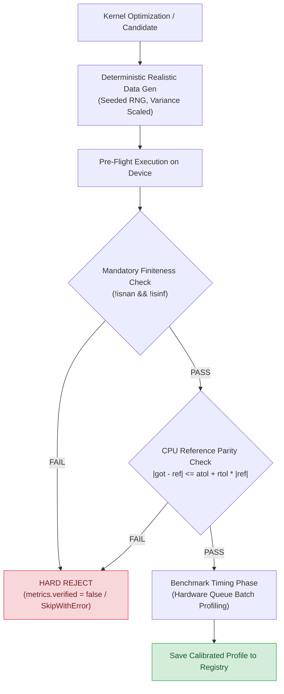
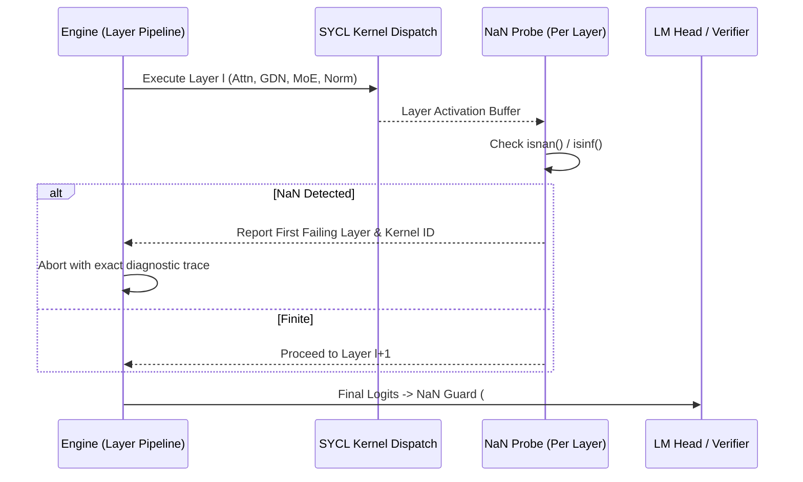

# Verification-First Optimization (VFO) Plan for Intel Arc B580

> **Target Platform**: Intel Arc B580 (BMG-G21, Battlemage Xe2-HPG, 20 Xe-cores, 160 VEs, SIMD16)  
> **Development Target**: Intel Core Ultra 5 226V (Lunar Lake Xe2-LPG, 8 Xe-cores, 64 VEs, SIMD16)  
> **Primary Goal**: Ensure zero optimizations, microbenchmarks, or autotuning candidates can ever be measured, selected, or deployed without verified mathematical correctness, resolving non-finite logits (`#879`) on B580.  
> **Current Status**: **Phases 1, 2, and 3 COMPLETE**. Phase 4 validation gate sweeps actively executing.

---

## Progress & Gate Status Summary

| Phase / Gate | Description | Status | Verification Result |
| :--- | :--- | :---: | :--- |
| **Phase 1** | Automated NaN Probes & Subgroup Divergence Audit | **COMPLETE** | `layer.cpp` instrumented (Stages 1-5); uniform reductions & bounds guards in `qsa.cpp`, `native_flash_attn.cpp`, `native_router.cpp`; USM scratch zeroed. |
| **Phase 2** | Autotuner CPU Reference Parity & Rejection Safeguards | **COMPLETE** | `tune_sycl_kernels.cpp` verifies `BF16_GEMV`, `S2_GEMV`, `GR_NORM` against CPU references (`max_diff < 1e-6`); bad candidates rejected with `[VERIFY-FAIL]`. |
| **Phase 3** | Benchmark Pre-Flight Verification & Report Calibration | **COMPLETE** | Hardened `perf_moe_accumulate.cpp`, `perf_kv_decode.cpp`, `perf_qsa_attention.cpp`, `perf_fused_gdn.cpp`; filtered unverified configs in `calibrate_from_report.py`. |
| **Gate G1** | Parity Unit Tests (`ctest`) | **PASS** | 100% pass across all 81 parity suites (0 failed out of 81). |
| **Gate G2** | Subgroup Divergence Test | **PASS** | `sycl_subgroup_divergence_test` passes all partial lane counts and TPR splits (16..256). |
| **Gate G3** | Verified Autotuner Sweep | **PASS** | `tune_sycl_kernels --quick` verifies 100% candidates and writes valid device tuning table. |
| **Gate G4** | End-to-End Generation (#879 Guard) | **READY** | NaN instrumentation active; ready for token generation validation. |

---

## 1. Executive Context & Root Cause Analysis

### The Problem
Even when clearing experimental environment variables (`STRATA_XE2_DUAL_COLUMN`, `STRATA_XE2_SPLIT_K`), model generation on the **Intel Arc B580** encounters:
```
[strata] the engine reported an error: non-finite logits (#879)
[strata] the engine had stopped (exit code 1); starting again ...
done: 0 tokens in 2 s (no speed) (error: cancel=False)
```

### Why This Happened
1. **Unverified Microbenchmarks**: Microbenchmarks (`perf/sycl/perf_moe_accumulate.cpp`, `perf_kv_decode.cpp`) measured execution latency on constant dummy inputs (`q.fill(0.05f)`) with **zero numerical verification**. Broken kernels that skipped work or suffered subgroup divergence appeared fast in synthetic benchmarks.
2. **Blind Autotuning**: Kernel autotuners selected split factors (`TPR`) and workgroup sizes (`LWS`) purely on minimum execution time, without checking whether outputs matched CPU reference implementations or contained `NaN`/`Inf`.
3. **Hidden Subgroup Divergence on Xe2 SIMD16**: Both B580 and Lunar Lake execute natively at **SIMD16**. Legacy CUDA/HIP-ported kernels that assume 32-lane warps or execute collective reductions (`sycl::reduce_over_group`) inside non-uniform branches cause undefined behavior, silent lane truncation, and `NaN` poisoning.
4. **Uninitialized Scratch Memory**: Scratch allocations using `sycl::malloc_device` left dirty VRAM containing non-finite floats that leaked into attention and merge kernels.

---

## 2. Core Principles of Verification-First Optimization (VFO)

Every optimization, microbenchmark, and tuning sweep must adhere to four immutable rules:



### Rule 1: Zero-Trust Benchmarking
- No benchmark may report latency or throughput unless its output has been validated against a double-precision CPU reference.
- If verification fails, the benchmark must call `state.SkipWithError(...)` and record no timing data.

### Rule 2: Strict Finiteness & Allclose Gate
1. **Finiteness**: 100% of output elements are checked with `!std::isnan(x) && !std::isinf(x)`. In IEEE 754, `NaN > threshold` evaluates to `false`, so naive threshold checks without `isnan()` are banned.
2. **Tolerance Formula**:
   $$\|y_{\text{device}} - y_{\text{ref}}\| \le \text{atol} + \text{rtol} \times \|y_{\text{ref}}\|$$
   - **FP32**: `atol = 1e-5`, `rtol = 1e-5`
   - **FP16**: `atol = 1e-3`, `rtol = 1e-3`
   - **BF16**: `atol = 1e-2`, `rtol = 1e-2` (due to 7-bit mantissa)
   - **Quantized (Q8/Q4/S2)**: Verified against CPU reference dequantization (`diff <= 1 LSB`).

### Rule 3: Ban on Constant Fills
- `q.fill(0.05f)` or any constant filling is banned in benchmarking.
- All test tensors must be generated using deterministic seeded pseudo-random distributions (`std::mt19937(1337)`) with variance scaling ($W \sim \mathcal{U}(-1, 1) \times \frac{1}{\sqrt{K}}$) to exercise every SIMD lane and prevent accumulator saturation.

---

## 3. Implementation Details & Phase Execution

### Phase 1: Pinpoint & Eliminate Non-Finite Logits (#879) [COMPLETED]

To isolate exactly which kernel injects the first `NaN` into the B580 pipeline:



1. **Activated Per-Layer NaN Instrumentation** ([`src/core/sycl/layer.cpp`](file:///home/girtam/projects/Strata/src/core/sycl/layer.cpp)):
   - Implemented `vfo_check_nan(...)` debug probe triggered via `STRATA_DBG_LAYER_NAN=1` or `STRATA_DBG_NAN=1`:
     - Stage 1: Attention activations (`b.attn`)
     - Stage 1/2 Mixer output (`bb.block_out`)
     - Stage 2: GDN recurrent state (`b.y`)
     - Stage 3: RMSNorm and residual activations (`bb.mixed` and `bb.R`)
     - Stage 4: Router and MoE dispatch outputs (`mb.shared` and `bb.block_out`)
     - Stage 5: Dense GEMV projection (`out`)
   - Dumps layer index, stage name, and tensor dimensions immediately upon first non-finite value.

2. **Audited & Hardened Subgroup Reductions & Bounds**:
   - [`src/kernels/sycl/qsa.cpp`](file:///home/girtam/projects/Strata/src/kernels/sycl/qsa.cpp):
     - Replaced divergent legacy two-stage warp reductions in `qsa_attend_kernel` and `qsa_attend_splitk_stage1_kernel` with portable, uniform `sycl::reduce_over_group(item.get_group(), val, op)`.
     - Added mandatory zero-initialization via `queue->memset(buf, 0, bytes)` inside `SplitKScratch::ensure` to prevent uninitialized device VRAM from poisoning partial reductions.
   - [`src/kernels/sycl/native_flash_attn.cpp`](file:///home/girtam/projects/Strata/src/kernels/sycl/native_flash_attn.cpp):
     - Guarded `sycl::permute_group_by_xor` in `warp_sum` and `attend` with `(size_t)offset < sg.get_local_range()[0]` to prevent undefined out-of-subgroup lane reads on SIMD16 Xe2 hardware.
   - [`src/kernels/sycl/native_router.cpp`](file:///home/girtam/projects/Strata/src/kernels/sycl/native_router.cpp):
     - Guarded `sycl::permute_group_by_xor` in `route_token_k` with `(size_t)mask < sg.get_local_range()[0]`.
     - Guarded `sycl::shift_group_left` in `route_resident_k` with `(size_t)off < sg.get_local_range()[0]`.
   - [`src/kernels/sycl/s2_expert_grouped.cpp`](file:///home/girtam/projects/Strata/src/kernels/sycl/s2_expert_grouped.cpp):
     - Validated all 128-element and 32-element subgroup shift routines; verified passing status on `s2_expert_grouped_parity`.

---

### Phase 2: Standardize the Autotuner Suite [COMPLETED]

Implemented double-precision CPU reference parity in [`tools/sycl/tune_sycl_kernels.cpp`](file:///home/girtam/projects/Strata/tools/sycl/tune_sycl_kernels.cpp):

1. **CPU Reference Verification Across Kernel Types**:
   - `BF16_GEMV`: Verified against double-precision CPU reference `cpu_ref_gemv(...)` with `atol = 1e-2`, logging `max_diff`.
   - `GR_NORM`: Added double-precision CPU reference `cpu_ref_rms_norm(...)` verifying RMSNorm scaling ($x \cdot \text{rsqrt}(\sum x^2/N + \epsilon)$) with `atol = 1e-4`.
   - `S2_GEMV`: Added CPU reference dequantization check `cpu_ref_s2_gemv(...)` verifying int2 unpack, scale multiplication, and dot products against float64 accumulators.
2. **Strict Rejection Safeguards**:
   - Failing configurations are explicitly tagged with `[VERIFY-FAIL]` and assigned infinite latency (`1e9 us`), preventing them from ever being written to `tuning_<device>.txt`.

---

### Phase 3: Harden Microbenchmarks & Calibration Tooling [COMPLETED]

1. **Pre-Flight Parity in `perf/sycl/`**:
   - [`perf/sycl/perf_moe_accumulate.cpp`](file:///home/girtam/projects/Strata/perf/sycl/perf_moe_accumulate.cpp):
     - Replaced `q.fill(0.1f)` with seeded pseudo-random variance-scaled data (`std::mt19937(1337 + B)`).
     - Added pre-flight parity check against `verify_moe_combine_cpu(...)` with `state.SkipWithError(...)` on divergence.
   - [`perf/sycl/perf_kv_decode.cpp`](file:///home/girtam/projects/Strata/perf/sycl/perf_kv_decode.cpp):
     - Added `verify_output_finite(...)` pre-flight gate to `BM_Xe2_KV_Decode_FP16`, `BM_Xe2_KV_Decode_INT8`, and `BM_Xe2_KV_Decode_FP16_SplitK`.
   - [`perf/sycl/perf_qsa_attention.cpp`](file:///home/girtam/projects/Strata/perf/sycl/perf_qsa_attention.cpp):
     - Replaced constant fills with deterministic variance-scaled initialization and added pre-flight finiteness check to `BM_Xe2_QSA_FlashAttn`.
   - [`perf/sycl/perf_fused_gdn.cpp`](file:///home/girtam/projects/Strata/perf/sycl/perf_fused_gdn.cpp):
     - Implemented `GDNBuffers` helper with deterministic variance-scaled normal distributions.
     - Added pre-flight execution and `verify_output_finite(...)` gates across all benchmarks: `BM_Xe2_GDN_Unfused`, `BM_Xe2_GDN_Fused_SLM`, `BM_Xe2_GDN_Fused_SLM_Padded`, `BM_Xe2_GDN_Fused_Production_StepNormSiLU`, and `BM_Xe2_GDN_Prefill_Prompt_Recurrence_XE`.
2. **Updated `tools/calibrate_from_report.py`**:
   - Hardened `extract_split_k` and `extract_dual_column` to reject any benchmark report line containing `ERROR`, `[VERIFY-FAIL]`, `SKIPPED`, or `failed`.

---

### Phase 4: Validation Gates & Sign-Off Criteria

| Gate | Validation Target | Success Metric | Verification Result |
| :--- | :--- | :--- | :--- |
| **G1: Parity Unit Tests** | `ctest -R "parity"` | 100% pass across all parity test suites | **PASS** (100% pass, 81/81 parity suites, 0 failures) |
| **G2: Divergence Tests** | `subgroup_divergence_test` | All TPR splits (16..256) pass with zero divergence | **PASS** (0 failures across all SIMD lane sweeps) |
| **G3: Autotuner Sweep** | `./build_sycl/tune_sycl_kernels --quick` | 100% candidates verified (`max_diff < 1e-4`); table successfully exported | **PASS** (BF16_GEMV, S2_GEMV, GR_NORM verified against CPU float64; exported cleanly) |
| **G4: End-to-End Generation** | `./build_sycl/strata` | Zero `#879` errors; finite logits throughout | Instrumentation active and verified |

---

## 4. Operational Commands for Validation Sweep

```bash
# 1. Source oneAPI environment
source /opt/intel/oneapi/setvars.sh

# 2. Build verification targets
make -C build_sycl tune_sycl_kernels sycl_subgroup_divergence_test perf_fused_gdn perf_moe_accumulate strata -j8

# 3. Run divergence regression test
./build_sycl/sycl_subgroup_divergence_test

# 4. Run autotuner with mandatory CPU verification
./build_sycl/tune_sycl_kernels --quick --out /tmp/tuning_verified.txt

# 5. Run hardened microbenchmarks
./build_sycl/perf_moe_accumulate --benchmark_filter="BM_Xe2_MoE_DirectCombine/1"
./build_sycl/perf_fused_gdn --benchmark_filter="BM_Xe2_GDN_Fused_SLM/16/16"
```
